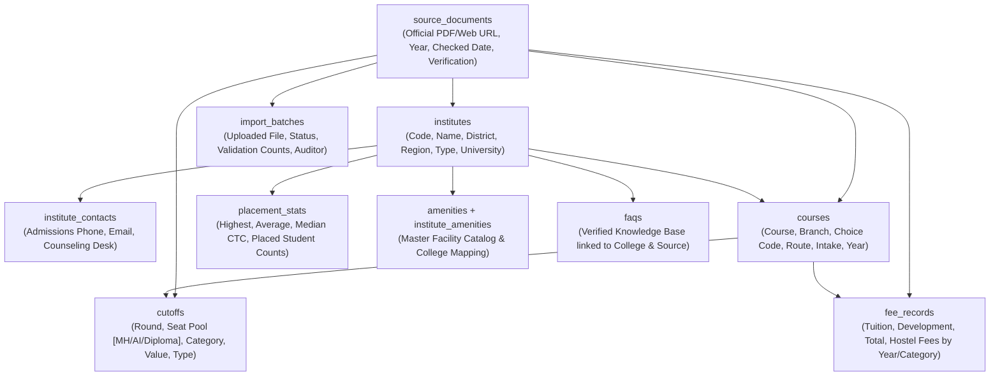

# CollegeHub: Smart College Inquiry and Assistance System

**CollegeHub** is a clean, trustworthy academic inquiry and assistance web platform designed for prospective students, parents, and campus visitors. It centralizes verified institutional information and features an AI Copilot that answers student questions **strictly from administrator-approved knowledge base entries**.

The frontend design and interactions faithfully recreate the **Stitch CollegeHub Academic Portal** design system in both **Light (Warm Academic Guidance)** and **Dark (Nocturne Collegiate)** modes.

---

## 🏛️ Comprehensive Screen Catalog

### 1. Core Usable Application Screens

| Screen | File | Primary Features |
| :--- | :--- | :--- |
| **Public Home** | [`index.html`](file:///c:/Users/LOQ/Desktop/campushub/index.html) | Hero with global inquiry search, 8 specialized category cards, preview FAQs, 3-step advisory process, floating AI Copilot modal, and theme toggle. |
| **FAQs & Chatbot** | [`faqs.html`](file:///c:/Users/LOQ/Desktop/campushub/faqs.html) | Desktop 2-column layout: searchable, filterable FAQ cards across 8 categories on the left; sticky interactive chatbot assistant on the right with strict approved-answer fallback. |
| **College Recommendations** | [`recommendations.html`](file:///c:/Users/LOQ/Desktop/campushub/recommendations.html) | Interactive 3-step advisory flow: student profile entry (MHT-CET, JEE Main, KCET), pre-submission review modal, and personalized college recommendations dashboard with 5-point historical cutoff cards, match badges (🟢 Historical match, 🟡 More competitive, ⚪ Insufficient cutoff data), filters, and sorting. |
| **Admin Console & Governance** | [`admin.html`](file:///c:/Users/LOQ/Desktop/campushub/admin.html) | Protected administrator portal with FAQ management, CSV data import for Maharashtra colleges, courses, fees, and cutoffs, live validation preview with duplicate detection, batch approval queue, and CSV export. |

---

### 2. Student Portal & Prototype Screens (Matching Stitch Export)

| Screen | File | Primary Features |
| :--- | :--- | :--- |
| **Sign In** | [`signin.html`](file:///c:/Users/LOQ/Desktop/campushub/signin.html) | Segmented role switcher (Student, Parent, Advisor), demo auto-fills, password reveal toggle, Campus SSO buttons, and quick navigation. |
| **Sign Up** | [`signup.html`](file:///c:/Users/LOQ/Desktop/campushub/signup.html) | Multi-step registration layout, program selection, password strength meter, and institutional terms agreement. |
| **Student Profile / Application Hub** | [`profile.html`](file:///c:/Users/LOQ/Desktop/campushub/profile.html) | Collegiate backdrop banner, applicant dossier (#CH-2025-8842), 4-step admission roadmap, submitted course preferences, assigned advisor card (`Dr. Elena Chen`), and 4-tab sub-navigation. |
| **Document Vault & Verification** | [`vault.html`](file:///c:/Users/LOQ/Desktop/campushub/vault.html) | Vault integrity score (83%), stat summary cards, simulated drag-and-drop file upload zone, document roster table with status badges (`Verified`, `Under Review`, `Action Needed`), and preview alerts. |
| **Saved FAQs & Counselor Chats** | [`saved.html`](file:///c:/Users/LOQ/Desktop/campushub/saved.html) | Bookmarked FAQs with personal student annotations, category filters, interactive direct messaging hub with Dr. Elena Chen, quick prompt chips, simulated typing indicator, and 1-on-1 advisory session booking modal. |
| **Account Settings & Security** | [`settings.html`](file:///c:/Users/LOQ/Desktop/campushub/settings.html) | "Back to Previous Step" action, sticky amber unsaved changes alert bar, 6 settings sections (Personal, Security & 2FA, Privacy/Proxy, Notifications, Linked SSO, Danger Zone), and the **exact Stitch Unsaved Changes Confirmation Modal** with dirty fields summary. |
| **About Institutional Mission** | [`about.html`](file:///c:/Users/LOQ/Desktop/campushub/about.html) | Institutional manifesto, 3 Pillars of guidance, 4 Guiding Principles, leadership & advisory council bios, security standards, and responsive header. |
| **Admin Login** | [`admin-login.html`](file:///c:/Users/LOQ/Desktop/campushub/admin-login.html) | Dedicated administrative sign-in portal with pre-filled demo credentials (`admin@collegehub.edu`). |

---

## 🎨 Stitch Design System Implementation

The application accurately incorporates the design tokens and aesthetics from the Stitch export:

- **Light Mode — Warm Academic Guidance:**
  - Canvas / Surface: Warm off-white (`#f9f9f8`)
  - Primary Text: Deep navy (`#0f1e36` / `#000412`)
  - Accent / Primary Actions: Forest teal (`#216963`)
  - Secondary Highlights: Soft mint (`#a8ece5`)
  - Cards & Containers: Crisp white (`#ffffff`) and soft-gray borders (`#e8e8e7`)
- **Dark Mode — Nocturne Collegiate:**
  - Canvas: Deep midnight navy (`#0d1320`)
  - Elevated Cards: Dark blue container (`#111a2e`)
  - Raised Elements: Deep collegiate surface (`#18233c`)
  - Primary Text: Pale crisp slate (`#f1f5f9`)
  - Accent / Action Links: Sky blue (`#38bdf8`) & emerald status accents
- **Typography:** Plus Jakarta Sans with fallbacks to system-ui.
- **Theme Persistence:** Toggle switches synchronize across all pages and persist in `localStorage` under the `collegehub-theme` key.

---

## 🗂️ Knowledge Base Categories (Exactly 8)

All FAQs, filters, and administration controls are organized into the 8 specified categories:
1. `admissions` — Eligibility criteria, application deadlines, required registration documents.
2. `courses` — Degree offerings, curriculum, credit transfer, honors tracks.
3. `fees` — Tuition fees, payment installment plans, refund policies, merit scholarships.
4. `cutoffs` — Centralized entrance percentiles, opening/closing ranks, quota minimums.
5. `placements` — Highest and average CTC, top recruiters, internship statistics.
6. `exams` — Semester examination schedules, relative grading patterns, re-evaluation.
7. `departments` — Academic departments, specialized research laboratories, computing clusters.
8. `facilities` — Campus hostels, dining halls, sports centers, libraries, health clinics.

---

## 🤖 Strict Chatbot Answering & Fallback Protocol

In accordance with academic trust principles:
- The chatbot **never invents** fees, cutoffs, dates, or placement figures.
- When an inquiry matches an approved FAQ, the assistant returns the verified answer with a category tag.
- When no reliable match exists in the knowledge base, the chatbot produces the strict fallback message:
  > *"I couldn't find a reliable answer to that question in the approved college FAQs. Please try rephrasing your question, searching our FAQ directory, or contacting college administrative staff directly."*

---

## 📦 Centralized Demo Data Architecture

All client-side prototype data is centralized in [`assets/js/demo-data.js`](file:///c:/Users/LOQ/Desktop/campushub/assets/js/demo-data.js):
- `CollegeHubData.categories`: The 8 canonical knowledge categories with icons and descriptions.
- `CollegeHubData.faqs`: Approved knowledge entries across all categories.
- `CollegeHubData.studentProfile`: Jordan Miller's applicant profile and roadmaps.
- `CollegeHubData.documents`: 6 verification records in the Document Vault.
- `CollegeHubData.counselorChats`: Thread history with Dr. Elena Chen.
- `CollegeHubData.matchChat(query)`: Robust keyword matching algorithm with strict fallback.
- `CollegeHubData.toggleTheme()`: Unified light/dark theme switcher with DOM updates.

---

## 🚀 How to Run the Application

### Option A: Static Frontend Demo (Directly in Browser)
No Python, Node.js, or server installation is required:
1. Open any `.html` file in your browser (e.g. double-click [`index.html`](file:///c:/Users/LOQ/Desktop/campushub/index.html) or [`profile.html`](file:///c:/Users/LOQ/Desktop/campushub/profile.html)).
2. Or serve via VS Code **Live Server** extension.
3. All interactive features (search, accordions, theme toggle, chatbot queries, unsaved changes modal, document verification triggers) function client-side.

### Option B: Full-Stack with Python & Flask Backend
1. **Install dependencies:**
   ```powershell
   python -m pip install -r requirements.txt
   ```
2. **Configure Environment:**
   The `.env` file is configured with your Supabase credentials. If setting up on a new environment, copy `.env.example` to `.env`:
   ```powershell
   copy .env.example .env
   ```
   *Note: If Supabase credentials are omitted or invalid, CollegeHub runs in transparent local fallback mode. The system will clearly notify administrators without pretending external database writes were committed.*

3. **Supabase Database Setup & Migrations (`schema.sql`):**
   - **Method A (Supabase Dashboard SQL Editor — Recommended)**:
     1. Open your project's SQL editor at [https://supabase.com/dashboard/project/uwaddyejdswshzamhjfs/sql/new](https://supabase.com/dashboard/project/uwaddyejdswshzamhjfs/sql/new).
     2. Copy and paste the complete contents of [`schema.sql`](file:///c:/Users/LOQ/Desktop/campushub/schema.sql).
     3. Click **Run**.
     *This creates the `faqs`, `admin_profiles`, and `faq_audit_log` tables, enables Row Level Security (RLS), configures visibility policies, sets up automated `updated_at` triggers, and seeds the initial verified knowledge base entries.*
   - **Method B (Direct Pooler Connection Script)**:
     If using the database connection pooler, set `DATABASE_URL` in `.env` and run:
     ```powershell
     python seed_db.py
     ```

4. **Run automated test suite:**
   ```powershell
   python -m unittest test_app.py
   ```
   *(All 12 comprehensive test suites pass with 100% test coverage across FAQ matching, admin auth & audit logging, HTML routing, college recommendations, CSV data import validation, and approval workflows)*

5. **Start the local server:**
   ```powershell
   python app.py
   ```

6. **Open in browser:**
   Navigate to [http://127.0.0.1:5000](http://127.0.0.1:5000)

---

## 🔐 Administrative Access & Security Architecture

### Administrator Setup & Role Management
- **Public Admin Registration is Prohibited:** There is intentionally no public signup endpoint for administrator accounts.
- **How Authorized Project Owners Invite Admins:**
  1. Navigate to the **Supabase Dashboard** -> **Authentication** -> **Users**.
  2. Click **Invite User** and enter the administrator's institutional email (e.g., `officer@collegehub.edu`).
  3. Supabase delivers an authenticated invitation link for password setup.
  4. Link the created user's UUID in the `admin_profiles` table:
     ```sql
     INSERT INTO admin_profiles (user_id, email, full_name, role, is_active)
     VALUES ('<supabase-auth-user-id>', 'officer@collegehub.edu', 'Admissions Officer', 'admin', TRUE);
     ```
  5. The administrator can now sign in at `/admin-login` with full RLS-authorized administrative capabilities.

### Row Level Security (RLS) & Protection Policies
- **`faqs` Table:**
  - **Public Visitors (`anon`):** Restricted strictly to `SELECT` on rows where `status = 'published' AND is_active = TRUE`.
  - **Authorized Admins (`authenticated`):** Granted full CRUD privileges only when matching an active record in `admin_profiles`.
  - **Server Service Role (`service_role`):** Used exclusively by the Flask backend server.
- **`admin_profiles` Table:**
  - Authenticated active admins can view roster profiles; all modifications require `service_role` or project owner.
- **`faq_audit_log` Table:**
  - Records every FAQ creation, update, publication, deactivation, and deletion with admin ID, username, diff payload, and UTC timestamp.
- **Password Security:**
  - Passwords are encrypted using PBKDF2/SHA-256 via Werkzeug (`generate_password_hash` / `check_password_hash`). Plaintext passwords are never stored or compared directly.

---

## 🧠 FAQ Matching Engine & Fallback Logic

CollegeHub uses a transparent, deterministic matching system rather than speculative LLMs:
1. **Preprocessing & Tokenization:**
   - Normalizes input queries into lowercase word tokens.
   - Filters non-discriminative English stopwords while preserving domain-critical academic tokens.
2. **Multi-Field Weighted Scoring:**
   - **Exact Phrase Substring Match:** +8.0 weight for question matches; +6.0 for keyword matches.
   - **Question Token Matches:** +3.5 for word-boundary matches; +2.0 for partial substring matches.
   - **Keyword Token Matches:** +3.0 for exact keyword matches.
   - **Category Alignment:** +2.5 when the token aligns with one of the 8 canonical categories.
   - **Token Coverage Multiplier:** Prevents spurious matches on multi-token inquiries (e.g. asking for "submarine parking fees" does not falsely match tuition fees because token coverage is below 40%).
3. **Strict Fallback Guarantee:**
   - If the top matching score falls below the confidence threshold (`4.0`), the system strictly refuses to speculate and outputs:
     > *"I couldn't find a reliable answer to that question in the approved college FAQs. Please try rephrasing your question, searching our FAQ directory, or contacting college administrative staff directly."*

---

## 🎓 Student Profile → College Recommendations Flow

CollegeHub features a verified, rule-based **Student Profile → College Recommendations** flow that matches prospective applicants to academic institutions using authenticated historical cutoffs:

### 1. Student Profile Input & Multi-Exam Validation
- **Configured Entrance Exams:** Multi-exam support including **MHT-CET**, **JEE Main**, and **KCET**.
- **Dynamic Result Types & Validation:**
  - `Percentile`: Validated strictly between `0.00` and `100.00`.
  - `Marks`: Validated between `0` and exam maximum (e.g. 200 for MHT-CET, 300 for JEE Main).
  - `Rank`: Validated as positive integer rank $\ge 1$.
- **Academic Credentials:** Class 10 and Class 12 percentages with minimum eligibility validation ($\ge 45\%$).
- **Admission Categories:** Dynamic category mapping based on the exam counseling authority (e.g., OPEN, OBC-NCL, EWS, SC, ST, TFWS).
- **Course & Prioritized Branches:** Students select their preferred course (B.Tech, B.Arch, MBA) and order multiple branch preferences by priority (e.g. #1 CSE, #2 AIDS, #3 ECE).
- **Location, Budget & Housing:** Preferred state/city, annual tuition budget threshold, and on-campus hostel preference.
- **Pre-Submission Review Modal:** Students can inspect and edit their submitted parameters before computing matches.

### 2. Recommendation Results & Match Badging
Every matching college program card displays:
- **Program & Institution:** College name, program title, campus location, annual tuition, and hostel availability.
- **Three Strict Match Classifications:**
  - 🟢 **Historical match**: The student's score meets or exceeds the verified closing cutoff (or student rank $\le$ cutoff rank).
  - 🟡 **More competitive**: Program cutoff is higher than the applicant's current score, with a plain-language delta indicating competitiveness.
  - ⚪ **Insufficient cutoff data**: Emerging or unverified branch/college where cutoffs are missing or pending; flagged explicitly rather than guessed.
- **5-Point Cutoff Verification Display:** Each recommendation displays the verified historical cutoff basis:
  1. Entrance Exam (e.g. MHT-CET)
  2. Admission Year (e.g. 2024 CAP)
  3. Category (e.g. OBC-NCL / GOBCH)
  4. Counseling Round (e.g. CAP Round II)
  5. Score Type & Closing Cutoff (e.g. 97.80 Percentile)
  - Accompanied by **Source Authority** (e.g. State CET Cell Maharashtra) and **Last-Verified Date**.
- **Filtering & Sorting:** Filter recommendations by match label, city, and branch; sort by student priority, cutoff selectivity, tuition cost, or college name.

### 3. Strict Recommendation Rules & Data Isolation
- **No Cross-Type Comparison:** Percentiles, ranks, and marks are strictly segregated and never compared directly against one another.
- **Strict Multi-Factor Alignment:** Matches evaluate only records matching the student's exam, score type, category, and preferred branch.
- **Transparent Guidance Disclaimer:** Historical cutoffs are presented strictly as directional guidance for planning and never as an admission guarantee.
- **Architectural Separation:** Recommendation logic and cutoff catalog are maintained cleanly in [`assets/js/recommendations.js`](file:///c:/Users/LOQ/Desktop/campushub/assets/js/recommendations.js) and the Flask API endpoint [`routes/api_recommendations.py`](file:///c:/Users/LOQ/Desktop/campushub/routes/api_recommendations.py) (`POST /api/recommendations`).

---

## 📊 Maharashtra Colleges, Courses, Fees & Cutoffs CSV Import Engine

CollegeHub provides a production-grade **CSV Data Ingestion & Governance Engine** allowing administrators to import authenticated Maharashtra institutional directories, academic fee structures, and historical Centralized Allotment Process (CAP) cutoffs.

### 1. Source Provenance & Mandatory Metadata
Every import batch captures strict audit metadata:
- **`source_url`**: Official portal where data was extracted (e.g., `https://fe2024.mahacet.org/StaticPages/HomePage` or DTE Maharashtra portal).
- **`academic_year`**: Centralized counseling academic year (e.g., `2024-2025` or `2024`).
- **`date_checked`**: Date the source was verified by the administrator (format `YYYY-MM-DD`).
- **`batch_name`**: Human-readable batch title and timestamp.

### 2. Comprehensive 18-Column Schema Dictionary
The blank CSV template ([`templates/maharashtra_colleges_cutoffs_template.csv`](file:///c:/Users/LOQ/Desktop/campushub/templates/maharashtra_colleges_cutoffs_template.csv)) and sample CSV ([`assets/data/maharashtra_colleges_cutoffs_sample.csv`](file:///c:/Users/LOQ/Desktop/campushub/assets/data/maharashtra_colleges_cutoffs_sample.csv)) define the following 18 columns:

| Column Header | Required? | Data Type & Constraints | Accepted Values | Maharashtra Example | Description |
| :--- | :--- | :--- | :--- | :--- | :--- |
| `college_code` | **Required** | Text (4-digit DTE Code) | DTE Maharashtra Institute Code | `6006`, `3012`, `6271` | Unique institutional identifier assigned by DTE Maharashtra. |
| `college_name` | **Required** | Text (max 255 chars) | Full university/institute name | `COEP Technological University` | Official institution title. |
| `campus_type` | Optional | Text | Classification string | `State University / Autonomous` | Autonomous, Government, or Private designation. |
| `district` | Optional | Text | Maharashtra District | `Pune`, `Mumbai Suburban`, `Nagpur` | Geographic district of the campus. |
| `city` | **Required** | Text | City Name | `Pune`, `Mumbai`, `Nagpur` | City location for regional student filtering. |
| `state` | **Required** | Text (Defaults to Maharashtra) | State Name | `Maharashtra` | Administrative state. |
| `program` | **Required** | Text | Academic Degree | `B.Tech`, `B.E.`, `B.Arch`, `MBA` | Academic degree course offered. |
| `branch_code` | **Required** | Text | Standard branch identifier | `CSE`, `AIDS`, `IT`, `ENTC`, `MECH` | DTE engineering branch abbreviation. |
| `branch_name` | **Required** | Text | Full branch title | `Computer Science & Engineering` | Complete program branch description. |
| `exam` | **Required** | Text | Entrance Examination | `MHT-CET`, `JEE Main`, `GATE` | Entrance exam used for seat allocation. |
| `score_type` | **Required** | `percentile`, `rank`, or `marks` | Case-insensitive score metric | `percentile`, `rank` | Score metric used for comparison. |
| `category` | **Required** | Text | Reservation Category | `OPEN`, `OBC-NCL`, `EWS`, `SC`, `ST` | Centralized counseling seat quota category. |
| `quota` | **Required** | Text | Counseling Quota Code | `SL` (State Level), `HU`, `OHU`, `AI` | Quota allocation under CAP rules. |
| `round` | **Required** | Text | Counseling Round | `CAP Round I`, `CAP Round II`, `CAP Round III` | Specific seat allocation round. |
| `cutoff_value` | Optional | Numeric (Decimal or Integer) | Percentile (0-100), Rank ($\ge$1), Marks ($\ge$0) | `99.8512`, `3406` | Historical closing score. If blank, registered as *Insufficient Data*. |
| `annual_fees_inr` | Optional | Numeric ($\ge$ 0) | Annual tuition in INR | `92000`, `110000`, `195000` | Approved tuition/development fee. If blank, preserved as null. |
| `hostel_available`| Optional | Boolean | `true`, `false`, `yes`, `no` | `true`, `false` | Campus residential hostel availability. |
| `remarks` | Optional | Text | Administrative notes | `CAP Round II merit closing allotment` | Audit and counselor notes. |

### 3. Rigorous Validation & Diagnostic Engine
When an admin clicks **Parse & Validate CSV**, the engine validates:
- **Missing Required Headers**: Rejects malformed CSVs with missing mandatory columns.
- **Missing Required Row Values**: Identifies rows missing `college_code`, `college_name`, `city`, `program`, `branch_code`, `branch_name`, `exam`, `score_type`, `category`, `quota`, or `round`.
- **Score Bounds Validation**:
  - `percentile`: Must be $0.00 \le \text{value} \le 100.00$.
  - `rank`: Must be positive integer $\ge 1$.
  - `marks`: Must be $\ge 0$.
- **Fee Validation**: Fees must be numeric $\ge 0$.
- **Duplicate College Code Conflict Detection**: Flags if a `college_code` is defined with conflicting college names across rows or against existing database colleges.
- **Duplicate Cutoff Record Detection**: Evaluates unique composite key `(college_code, exam, academic_year, round, branch_code, category, quota, score_type)`. Catches duplicate rows within the uploaded file and flags identical records already registered in the database.

### 4. Zero Hallucination Guarantee (Never Invent Missing Info)
- If `annual_fees_inr` is blank in the CSV, it is stored as `null`. We **never** invent or estimate fees.
- If `cutoff_value` is blank, it is stored as `null` with label **Insufficient cutoff data**, safely advising students that historical cutoffs are pending initial allocation.
- If `hostel_available` is blank, it is stored as `null` rather than guessing housing status.

### 5. Staging & Approval Governance Workflow
1. **Upload & Live Preview**: The admin inspects summary KPIs (Total, Valid 🟢, Errors 🔴, Duplicates 🟡) and filters the table.
2. **Commit to Staging**: Clicking **Import Valid Records** creates an `import_batches` record and inserts rows with:
   - `status = 'pending_approval'`
   - `is_active = FALSE`
3. **Strict Student Isolation**: Unapproved records are strictly excluded from public student searches and the `/recommendations` API.
4. **Approval Queue**: Administrators inspect batch records in the Approval Queue and click **Approve & Publish**. Only then are records marked `status = 'approved'` and `is_active = TRUE`, immediately activating them in the College Recommendations matrix!

---

## 🗄️ Normalized Relational Database Architecture (PostgreSQL & Supabase)

CollegeHub employs a fully normalized relational schema instead of a giant monolithic table. Every institution, contact, course, cutoff, fee, placement metric, campus facility, and FAQ retains its academic year and links back to its verified official source document.

### 1. Core Relational Hierarchy



### 2. Comprehensive Relational Tables Specification

| Table | What It Stores | Primary Keys & Relations | Key Columns & Constraints |
| :--- | :--- | :--- | :--- |
| `source_documents` | Official PDF/page URL, academic year, date checked, verification status | `id` (UUID PK) | `title`, `source_type` (`GOVERNMENT_PORTAL`, `GOVERNMENT_GAZETTE`), `source_url`, `academic_year`, `checked_at`, `verified` (default `FALSE`), `notes` |
| `institutes` | College code, name, district, address, website, type | `id` (UUID PK), `source_id` $\rightarrow$ `source_documents(id)` | `institute_code` (Unique), `institute_name`, `district`, `region`, `address`, `pincode`, `website`, `institute_type`, `university_name`, `is_published` (default `FALSE`) |
| `institute_contacts` | Admissions phone/email and other contact details | `id` (UUID PK), `institute_id` $\rightarrow$ `institutes(id)` ON DELETE CASCADE | `contact_type` (`admissions_phone`, `general_phone`, `email`, `counseling_desk`), `contact_value`, `department`, `is_published` |
| `courses` | Course, branch, choice code, route, intake, academic year | `id` (UUID PK), `institute_id` $\rightarrow$ `institutes(id)` ON DELETE CASCADE | `academic_year`, `admission_route` (`BTECH_FIRST_YEAR`, `BTECH_DSY`, `DIPLOMA_AFTER_SSC`), `choice_code`, `course_name`, `branch`, `intake`, `is_published`, `UNIQUE(academic_year, choice_code)` |
| `cutoffs` | Round, MH/AI/source seat label, category, cutoff value and type | `id` (UUID PK), `course_id` $\rightarrow$ `courses(id)` ON DELETE CASCADE | `academic_year`, `cap_round` (Integer), `seat_pool` (Source label: `MH`, `AI`, `Diploma`), `category`, `seat_type_code` (Official code: `GOPENH`, `GOBCH`, `TFWS`), `cutoff_value`, `cutoff_type` (`percentile`, `rank`, `marks`), `is_published` |
| `fee_records` | Course fees by year, component, category/quota | `id` (UUID PK), `course_id` $\rightarrow$ `courses(id)` ON DELETE CASCADE | `academic_year`, `fee_component` (`tuition`, `development`, `total`, `hostel`), `category`, `quota`, `amount`, `currency` (default `'INR'`), `is_published` |
| `placement_stats` | Highest, average, or median figures—kept as separate metrics and years | `id` (UUID PK), `institute_id` $\rightarrow$ `institutes(id)` ON DELETE CASCADE | `course_id` $\rightarrow$ `courses(id)`, `academic_year`, `metric_type` (`highest`, `average`, `median`), `amount`, `students_placed`, `total_students`, `is_published` |
| `amenities` + `institute_amenities` | Master facility list and which colleges have each facility | `amenities.id` (UUID PK), `institute_amenities.id` (UUID PK) | Master amenities: `name`, `category`, `icon`, `description`. Mapping: `(institute_id, amenity_id)` Unique, `details`, `is_published` |
| `faqs` | Verified answers for the college inquiry chatbot | `id` (UUID PK), `institute_id` $\rightarrow$ `institutes(id)` (optional) | `question`, `answer`, `category` (8 categories), `keywords`, `status` (`published`, `draft`, `inactive`), `is_active`, `source_id` |
| `admin_users` + `admin_profiles` | Authorized staff who can manage data | `id` (UUID PK), `admin_profiles.user_id` $\rightarrow$ `auth.users(id)` | `username`, `password_hash`, `role` (`superadmin`, `admin`, `editor`), `is_active` |
| `import_batches` | Uploaded PDF/CSV name, import status, and row counts | `id` (UUID PK), `source_document_id` $\rightarrow$ `source_documents(id)` | `batch_name`, `source_url`, `academic_year`, `date_checked`, `file_type`, `total_rows`, `valid_rows`, `error_rows`, `duplicate_rows`, `status` (`pending_approval`, `approved`, `rejected`) |
| `faq_audit_log` | Audit trail recording created or changed FAQs and batches | `id` (UUID PK), `faq_id` $\rightarrow$ `faqs(id)` | `admin_username`, `action` (`create`, `update`, `publish`, `deactivate`), `changes` (JSONB), `created_at` |

---

### 3. Crucial Domain Architectural Rules

#### A. Seat Pool vs. Admission Route Strict Segregation
- **`cutoffs.seat_pool`**: Retains the official printed seat pool from counseling matrix sources (`MH` for Maharashtra State, `AI` for All India, `Diploma` for Diploma quota seats within a degree course).
- **`courses.admission_route`**: Represents the candidate's academic entry route (`BTECH_FIRST_YEAR`, `BTECH_DSY` for Direct Second Year Lateral Entry, `DIPLOMA_AFTER_SSC` for post-10th polytechnics).
- **Why this matters**: In Maharashtra counseling, an engineering course in First Year (`BTECH_FIRST_YEAR`) often reserves specific quota seats for polytechnic diploma holders (`seat_pool = 'Diploma'`). Keeping these attributes separate ensures that a Diploma seat quota within a first-year cutoff matrix is **never conflated** with the separate `BTECH_DSY` (Direct Second Year lateral entry) counseling process.

#### B. Stateless In-Memory Recommendation Evaluation (No Student Table)
In accordance with user privacy and the system design principles:
- The recommendation engine evaluates candidate entrance marks, percentages, admission category, and course preferences **entirely in memory**.
- Candidate parameters are passed in the POST payload to `/api/recommendations`, matched against approved cutoffs, and returned instantly without creating, updating, or persisting any records in a student table.

#### C. Row Level Security (RLS) & Publication Gates
- **Row Level Security (RLS)** is enabled on all tables in PostgreSQL.
- Public anonymous users (`anon`) have `SELECT` access **strictly restricted** to records where `is_published = TRUE` (and for source documents, `verified = TRUE`).
- Unapproved import batches, draft FAQs, and newly imported courses remain invisible to students until an authorized administrator explicitly verifies the source and approves the batch.

#### D. Zero Hallucination Guarantee
- Missing fees, cutoffs, or amenities are preserved as `null`. We never fabricate, estimate, or extrapolate missing academic figures.

---

### 4. Normalized Relational API Routes

| Endpoint | Method | Access | Description |
| :--- | :--- | :--- | :--- |
| `/api/institutes` | `GET` | Public | List published institutions with filtering by `district`, `type`, and search query `q`. Enriched with contact count, course count, and facility count. |
| `/api/institutes/<id>` | `GET` | Public | Complete institute profile: college details, contacts, courses (with nested cutoffs & fees), placement statistics, campus amenities, and source provenance. |
| `/api/courses` | `GET` | Public | List courses with filters for `institute_id`, `route` (`BTECH_FIRST_YEAR`, `BTECH_DSY`), and `academic_year`. Enriched with institute name and code. |
| `/api/amenities` | `GET` | Public | Retrieve master catalog of campus amenities and academic infrastructure. |
| `/api/sources` | `GET` | Public | Retrieve verified official source documents retaining origin URL, verification date, and title. |

---

## 🧪 Verified User Journeys Summary

All 12 primary user journeys have been end-to-end verified across the unit test suite (`test_app.py`):
1. ✅ **Search for an FAQ:** Keyword searches (`scholarships`, `documents`) filter published entries accurately.
2. ✅ **Ask Question with Match:** Verified questions return approved text and category tags.
3. ✅ **Ask Question without Match:** Unapproved/unrelated inquiries trigger the mandatory academic fallback message.
4. ✅ **Admin Authentication:** Secure sign-in at `/admin-login`, session issuance, `/api/admin/me` status check, and logout.
5. ✅ **Create & Edit FAQ:** Admins can draft FAQs; unpublished drafts remain invisible to public visitors and the chatbot.
6. ✅ **Publish FAQ:** Promoting an entry to `published` instantly indexes it for public search and chatbot answering.
7. ✅ **Confirm Public Visibility:** Published FAQ immediately appears in global search and is eligible for chatbot answering.
8. ✅ **Deactivate FAQ:** Deactivating an FAQ sets `is_active = FALSE` / `status = inactive`, instantly purging it from public search and chatbot retrieval.
9. ✅ **Student Profile → College Recommendations:** Input exam score, category, and prioritized branches; review profile; compute type-safe recommendations categorized into Historical match, More competitive, and Insufficient cutoff data with verified cutoff criteria.
10. ✅ **Maharashtra Colleges & Cutoffs CSV Import:** Upload CSV, validate source URL/academic year/date checked, preview row diagnostics and duplicate warnings, stage records as pending approval, review batch in approval queue, and publish to live student recommendations.
11. ✅ **Relational Institutional Explorer & Course Inspector:** Query colleges (`/api/institutes`), view nested contacts, courses, cutoffs, fees, placement stats, amenities, and verified source provenance.
12. ✅ **Seat Pool vs. Admission Route Strict Isolation:** Query first-year courses with diploma or state quotas, verifying that `cutoffs.seat_pool` is preserved and never conflated with `courses.admission_route`.

---

## 🔒 Security & Admin Demo Credentials
- **Admin Portal URL:** `/admin-login` (or direct file `admin-login.html`)
- **Admin Email / Username:** `admin@collegehub.edu` (or `admin`)
- **Admin Password:** `admincollegehub` (or `AdminCollege2025!`)
*(Click the "Autofill" button on the sign-in card to populate instantly)*
# campushub
